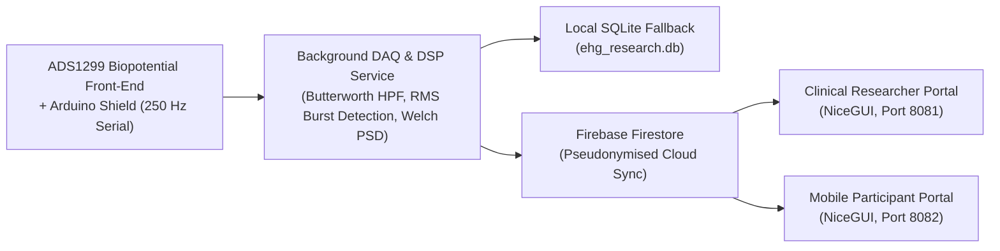

# MYOWAVE: Non-Invasive Electrohysterography (EHG) Diagnostic Platform

[](https://www.python.org/)
[](https://nicegui.io/)
[](LICENSE)

**Winner of the Year 2 Molecular Bioengineering Prize for Best Design Group Project (Imperial College London).**

MYOWAVE is a full-stack non-invasive electrohysterography (EHG) diagnostic platform built to acquire, filter, and analyse uterine electrical activity for longitudinal menstrual health research (evaluated for the **ENDO1000** clinical study targeting endometriosis, adenomyosis, and dysmenorrhoea).

## System Architecture



## Key Features

- **Real-Time DSP Engine (`nicegui_site/background_service.py`, `dsp_math.py`):** Samples 250 Hz serial EHG streams from an ADS1299-6PAGR biopotential front-end, applies a 2nd-order 0.3 Hz high-pass Butterworth filter, detects contraction bursts via RMS thresholding (0.04 RMS, discarding transients under 0.2 s), and extracts Welch power spectral density across Fast Wave Low (0.34-1.0 Hz) and Fast Wave High (1.0-3.0 Hz) bands.
- **Clinical Researcher Portal (`dashboard.py`, `page_*.py`):** Authenticated NiceGUI desktop dashboard (port 8081) for live hardware session control, cohort morphological analysis with Plotly, longitudinal patient tracking, and CSV dataset export.
- **Mobile Participant Portal (`patient_app.py`):** Mobile-first web app (port 8082) for PIN-based participant sign-in, cycle-day syncing, pain logging, and live device connectivity status.
- **Dual Local & Cloud Persistence (`config_db.py`):** Syncs pseudonymised event summaries to Firebase Firestore while maintaining a local SQLite database for resilient offline capture.
- **Hardware Bench Verification (`Signal Testing/`, `test_codes/`):** Live PyQtGraph acquisition and automated test scripts verifying bandwidth attenuation (`T1_bandwidth_attenuation.py`), local event capture (`T2_local_events.py`), and 50 Hz common-mode rejection ratio (`T3_CMRR.py`).

## Repository Structure

| Path | Description |
| :--- | :--- |
| `nicegui_site/launcher.py` | Master entry point launching the DAQ service, both NiceGUI portals, and optional Cloudflare Quick Tunnels. |
| `nicegui_site/background_service.py` | Continuous 250 Hz serial acquisition and real-time burst extraction service. |
| `nicegui_site/dsp_math.py` | Butterworth filtering, RMS event detection, and Welch PSD feature extraction. |
| `nicegui_site/dashboard.py` & `layout.py` | Authenticated researcher portal routing, session lifecycle failsafes, and shared layout. |
| `nicegui_site/page_*.py` | Modular views for session control (`page_manager.py`), cohort analysis (`page_cohort.py`), patient history (`page_patient.py`), and exports (`page_export.py`). |
| `nicegui_site/patient_app.py` | Standalone mobile-first participant web portal. |
| `nicegui_site/config_db.py` | SQLite schema setup and Firebase Firestore initialisation. |
| `nicegui_site/generate_synthetic_data.py` | Synthetic clinical cohort generator for end-to-end portal testing. |
| `Signal Testing/` | PySerial and PyQtGraph live/period capture scripts (`CapturePeriod.py`, `LiveCapture.py`). |
| `test_codes/` | Hardware verification scripts (`T1_bandwidth_attenuation.py`, `T2_local_events.py`, `T3_CMRR.py`). |

## Getting Started

1. **Clone and install dependencies:**
   ```bash
   git clone https://github.com/aahmeddev/myowave-ehg-platform.git
   cd myowave-ehg-platform
   pip install -r requirements.txt
   ```

2. **Configure credentials (local environment):**
   - Place your Firebase service account JSON at `nicegui_site/firebase_key.json` (or set `FIREBASE_KEY_PATH`).
   - Optionally set `MYOWAVE_ADMIN_PASSWORD` and `MYOWAVE_STORAGE_SECRET` as environment variables.
   - *(Optional)* Install [cloudflared](https://developers.cloudflare.com/cloudflare-one/connections/connect-networks/downloads/) on your PATH for remote Quick Tunnel access.

3. **Launch the platform:**
   ```bash
   cd nicegui_site
   python launcher.py
   ```
   - Researcher portal: `http://localhost:8081`
   - Participant portal: `http://localhost:8082`

## License

Released under the [MIT License](LICENSE).
